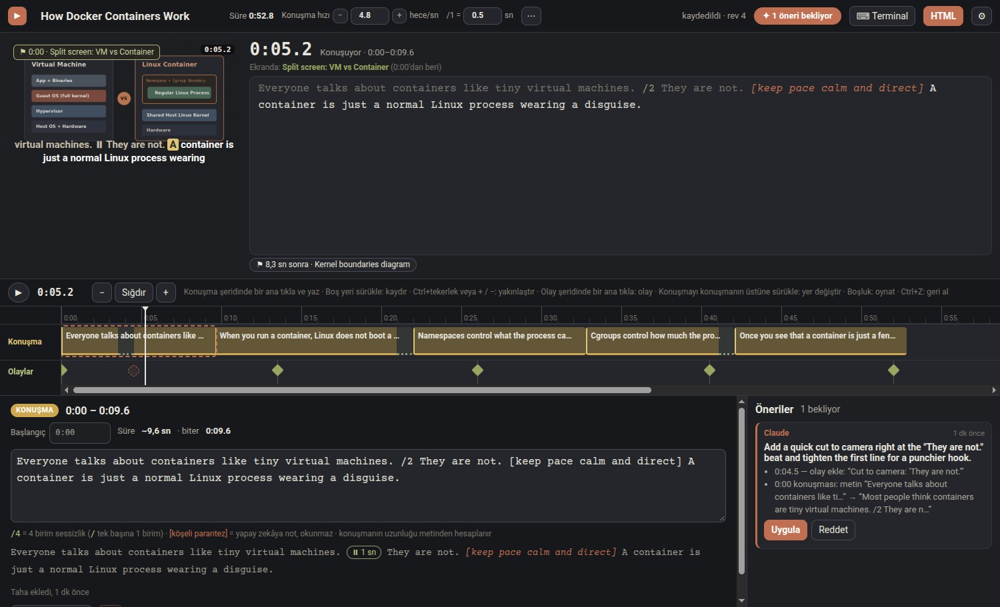
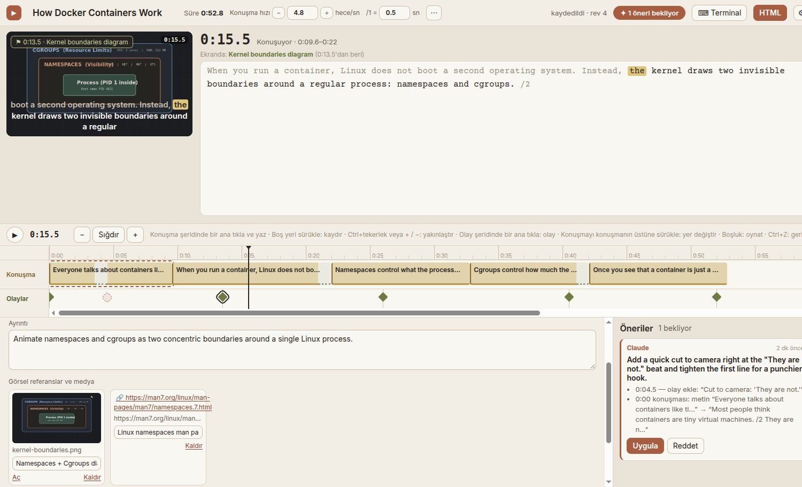
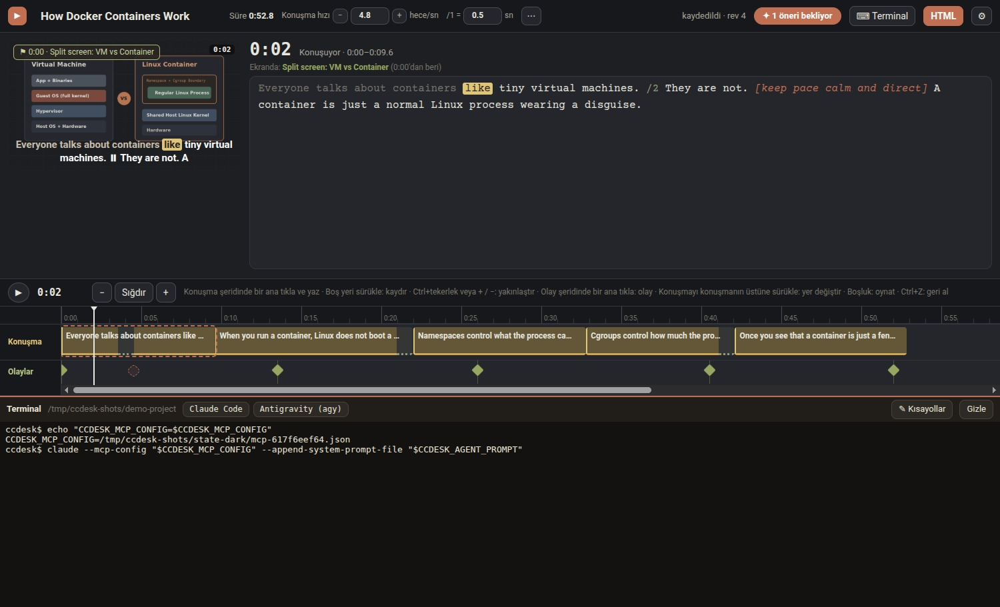
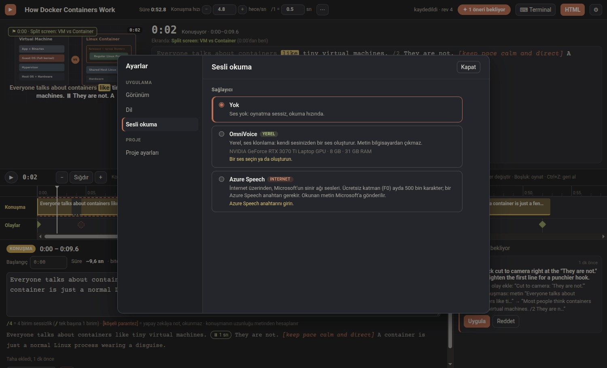

# ccdesk

A desktop planning desk for deciding what gets said, when it gets said, and what appears on screen before you start recording or editing a video.



## What it is (and what it is not)

Planning a video in a plain text editor gives you no sense of timing. You cannot tell whether a paragraph takes 12 seconds or 40 seconds to say, and it is easy to lose track of which visual matches which sentence. On the other hand, opening a video editor just to figure out pacing and structure is slow and heavy.

**ccdesk** (formerly **Kurgu Masası**) sits between a script document and a video editor. You write spoken lines on a timeline, attach visual cues and reference media to exact seconds, listen to the pacing, and optionally collaborate with an AI assistant over MCP.

To keep scope clear, here is what ccdesk is **not**:

- **Not a video editor.** It does not cut footage, composite layers, apply effects, or render video files.
- **Not an AI video generator.** It does not generate final video clips for you.
- **Not locked to one AI tool.** It works completely offline with no AI at all, or with any MCP-capable CLI assistant you choose.
- **Not a cloud service.** Every project is a plain local folder on your disk (`ccdesk.json`, copied media files, and revision history).

> **Interface language note:** The desktop UI is currently in Turkish, while project scripts, syllable timing, and read-aloud voices support both **Turkish (`tr`)** and **English (`en`)**.

## How it works

### Continuous script flow and reading time

Spoken script blocks sit back to back from `0:00` in one continuous flow with no gaps and no overlaps. Each block's duration is calculated directly from its text using your project's content language, speaking speed (syllables per second), and punctuation pauses.

Inside any script block, two lightweight markers control pacing and AI notes:

- `/n` inserts `n` units of silence (`/` alone equals 1 unit, and the unit duration is set in the top bar).
- `[square brackets]` hold directions or placeholders for you and your AI assistant. They are never counted in reading time and never read aloud.

When you edit a script or drag one block onto another to swap their order, every following block reflows automatically, and on-screen events stay attached to the script they belong to.

### On-screen events, media references, and live preview

Below the speech lane, the events lane marks what happens on screen at any moment, such as camera cuts, diagrams, or B-roll notes. Each event can hold local images, videos, audio clips, documents, or URLs. Local files are copied into the project's `medya/` folder so the project stays self-contained.



The resizable screen panel at the top previews whatever is under your mouse or playhead: the active visual reference, the exact word being spoken, and upcoming events within the next few seconds. Press `Space` to play through the plan at reading speed. You can switch between light and dark themes and pick separate UI and script fonts in Settings (`Ctrl+,`).

When the plan is ready, press `Ctrl+E` (or click **HTML**) to export a single self-contained HTML sheet listing every timestamp, spoken line, silence, and visual to prepare.

### Built-in terminal, MCP collaboration, and revision diffs

Press ``Ctrl+` `` to open a built-in login shell right inside the active project folder. ccdesk never starts an AI tool automatically. Instead, customizable shortcut buttons in the terminal header (preconfigured with **Claude Code** and **Antigravity (`agy`)**, plus your own global or per-project commands) paste the launch command onto the prompt line so you decide when to press Enter.



The terminal automatically exports `CCDESK_MCP_CONFIG`, `CCDESK_AGENT_PROMPT`, `CCDESK_MCP_COMMAND`, and `CCDESK_MCP_SERVER`. Any MCP-capable assistant connected to the project can:

- See where your playhead, mouse cursor, and selection are right now (`ccdesk_cursor`).
- Read the full timeline and estimate reading durations (`ccdesk_timeline`, `ccdesk_estimate_reading`).
- Inspect full revision history and word-level diffs between any two revisions (`ccdesk_history`, `ccdesk_diff`).
- Propose edits as pending suggestions (`ccdesk_suggest`) rather than overwriting your work directly.

Pending suggestions appear on the timeline as dashed outlines and in the right-hand panel with one-click accept or reject buttons. Every change in the app, including accepted suggestions, supports undo and redo (`Ctrl+Z` / `Ctrl+Shift+Z`).

### Read-aloud playback (optional)

If you want to hear your pacing instead of reading silently, enable a read-aloud provider in **Settings > Sesli okuma** (`Ctrl+,`). When **Okuma hızına eşitle** (sync to reading speed) is on, ccdesk calibrates the voice speed to match your project's syllables-per-second target while keeping natural pitch. Generated clips are cached locally.



## Dependencies

### Required

- **Node.js 20+** and **npm**: runs Electron, xterm.js, the MCP server (`@modelcontextprotocol/sdk`, `zod`), and bundled fonts.
- **Linux or macOS with Python 3** (standard library only): used by `src/main/pty-helper.py` to provide a pseudo-terminal for the built-in shell without native Node compilation.

### Optional

You can use ccdesk without any of the items below. Each one unlocks an optional capability:

| Optional dependency | What it enables | Requirements |
|---|---|---|
| **MCP-capable AI CLI** (Claude Code, Antigravity `agy`, etc.) | In-app AI collaboration, cursor awareness, suggestions, and revision diffs | Installed in your `PATH` and launched from the built-in terminal or configured externally |
| **OmniVoice** (local TTS & voice cloning) | Offline read-aloud using cloned voices; text never leaves your machine | NVIDIA GPU with at least 4 GB VRAM (`nvidia-smi`), at least 8 GB RAM, `ffmpeg`, and a Python virtualenv containing `torch`, `soundfile`, and `omnivoice` (`k2-fsa/OmniVoice`) |
| **Azure AI Speech** (cloud TTS) | Neural voices in Turkish and English over REST (free F0 tier gives 500,000 chars/month) | Internet connection, Azure Speech API key, and region (key is stored encrypted via Electron `safeStorage`) |

For **OmniVoice**, ccdesk automatically checks hardware requirements before enabling the option. Point it to your OmniVoice Python binary by setting the `CCDESK_TTS_PYTHON` environment variable or adding `"ttsPython": "/path/to/.venv/bin/python"` to `~/.config/ccdesk/state.json`.

## Installation

Clone the repository and install Node dependencies:

```bash
git clone https://github.com/tahameg/ccdesk.git
cd ccdesk
npm install
```

Start the desktop app:

```bash
npm start
```

## Usage

### Working on a project

1. Click **Yeni proje** (New project) to pick an empty folder, or **Proje aç** (Open project) to open an existing one.
2. Click anywhere on the **Konuşma** (Speech) lane to add a script block, or on **Olaylar** (Events) to mark a visual moment.
3. Drag empty space to pan, use `Ctrl + scroll` or `+` / `-` to zoom, and press `0` to fit the whole timeline.
4. Drag a script block onto another script block to swap their places in the flow. Drag an event diamond (or nudge it with `Left` / `Right` arrows) to adjust its timing.
5. Press `Space` to play at reading speed (silently or with read-aloud enabled).

### Keyboard shortcuts

| Shortcut | Action |
|---|---|
| `Space` | Play or pause at reading speed |
| `Ctrl+N` / `Ctrl+O` | New project / Open project |
| `Ctrl+Z` / `Ctrl+Shift+Z` | Undo / Redo |
| ``Ctrl+` `` | Toggle built-in terminal |
| `Ctrl+,` | Open settings |
| `Ctrl+E` | Export HTML plan |
| `+` / `-` / `0` | Zoom in / Zoom out / Fit timeline |
| `Left` / `Right` | Step playhead (or nudge selected event by 0.1s; hold `Shift` for 1s) |
| `Delete` / `Backspace` | Delete selected script or event |

### Standalone MCP server

If you prefer connecting an external MCP client outside the built-in terminal, run:

```bash
CCDESK_PROJECT=/path/to/your-project npm run mcp
```

If `CCDESK_PROJECT` is omitted, the MCP server targets whichever project is currently open in the ccdesk app.

### Project folder layout

Each project lives in a self-contained folder:

```text
my-video/
├── ccdesk.json          # Scripts, events, settings, and suggestions
├── medya/               # Copied images, videos, audio, and reference files
├── .ccdesk-history/     # Revision log and base snapshots for diffs
├── .ccdesk-ui.json      # Current cursor and selection state for MCP tools
├── .ccdesk-shortcuts.json # Optional per-project terminal shortcuts
└── disa-aktarim/        # Exported HTML files
```

App-wide preferences, voice profiles, encrypted API keys, and TTS cache live in `~/.config/ccdesk` (override with `CCDESK_STATE_DIR`). Legacy projects created under the old name (`kurgu.json` and `~/.config/kurgu-masasi`) are migrated automatically on first open.

## Development

Run the test suite:

```bash
npm test
```

Capture a headless UI screenshot of a project (use `CCDESK_STATE_DIR` to keep your personal settings untouched):

```bash
CCDESK_STATE_DIR=/tmp/ccdesk-test npm run smoke -- /path/to/project out.png [item-id] [px-per-sec] [time]
```

You can also pass `CCDESK_SMOKE_JS=/path/to/script.js` to run a small script inside the Electron renderer before the screenshot is captured. For internal architecture details, see [CLAUDE.md](CLAUDE.md).
